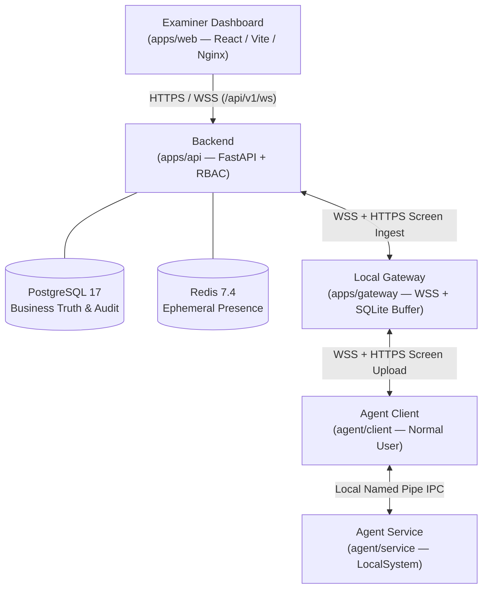

# Exam Environment Control Platform (EECP)

> **Protocol v2** exam-environment control and proctoring platform combining a central **FastAPI Backend**, a room-local **Gateway**, a normal-user **Agent Client**, a privileged **Windows Agent Service**, and a **React/Vite Examiner Dashboard**.

---

## Architecture Overview



### Trust & Responsibility Boundaries

- **Backend (`apps/api`)**: Authoritative source of truth for identities, RBAC (`ADMIN` / `EXAMINER` with `session_examiners` scoping, `/api/v1/auth/logout` `jti` revocation, and `/api/v1/ws` `ping` re-validation), exam sessions, policies, commands, ACKs, incidents, screen evidence, and audit logs.
- **Local Gateway (`apps/gateway`)**: Routes Protocol v2 commands/ACKs unchanged over WSS and durably buffers Events and screen frames in SQLite during WAN outages.
- **Agent Client (`agent/client`)**: Runs as a normal user (no signing keys), owns sensors, screen ring/evidence capture, and transport to the Local Gateway.
- **Agent Service (`agent/service`, `agent/infrastructure`)**: Runs under Windows `LocalSystem`, independently verifies Backend HMAC-SHA256 policy/command proofs against a bounded replay journal, and enforces hosts, Windows Firewall, process termination, and USB policies.
- **Named Pipe (`agent/ipc`)**: Local-only IPC with machine-local ACLs; it enables normal-user Client communication and is never treated as proof of Backend command authority.

---

## Repository Layout

| Path | Role |
|---|---|
| `apps/api/` | FastAPI Backend, PostgreSQL/SQLite persistence (`0001`–`0003` migrations), Redis presence, RBAC & HMAC signing |
| `apps/gateway/` | Local Gateway, WSS routing, SQLite durable Event buffer & screen spool |
| `apps/web/` | React/Vite Examiner Dashboard (served by Nginx in Docker) |
| `agent/client/` | Normal-user transport, sensors, and RAM screen capture |
| `agent/service/` | Privileged Windows Service, replay journal, security event journal, maintenance loop |
| `agent/ipc/` | Local Named Pipe framing, ACLs, and security-event IPC |
| `agent/infrastructure/` | Windows enforcement adapters (`hosts`, Windows Firewall, process, USB) |
| `contracts/v2/` | Shared Protocol v2 contracts (commands, events, ACKs, policy, presence, screen) |
| `scripts/benchmark/` | Repeatable loopback Gateway benchmark harness |
| `scripts/windows/` | Windows Service, IPC token, Firewall, and release validation helpers |
| `docs/v2/` | Canonical architecture, security, screen-evidence, and operations docs |

---

## Quick Start (Local Development)

### 1. Backend & Web Dashboard

```powershell
# Install Python workspace packages
uv sync --all-packages

# (PostgreSQL only) Run migrations first:
# uv run --package eecp-api python -m app.infrastructure.persistence.migrate

# Start Backend API
uv run --package eecp-api uvicorn app.main:app --app-dir apps/api --reload

# Start Examiner Dashboard
Set-Location apps/web
npm install
npm run dev
```

### 2. Local Gateway

Configure the required `EECP_GATEWAY_*` environment variables (see [docs/v2/gateway-on-server.md](docs/v2/gateway-on-server.md)), then run:

```powershell
uv run python -m apps.gateway.app.main
```

### 3. Agent Client & Service (Windows)

Run **Agent Client** as a normal user connected to the Local Gateway — do **not** run the Client as Administrator to bypass a missing Service. Install and run **Agent Service** separately under Windows SCM/`LocalSystem` (see [docs/v2/final-demo-guide.md](docs/v2/final-demo-guide.md)).

---

## Production-like Docker Stack

Copy `.env.example` to a protected local `.env`, replace all placeholder secrets and certificate paths, then launch:

```powershell
# Standard stack (PostgreSQL 17, Redis 7.4, migrate, API, Web)
docker compose up -d --build

# With same-host Local Gateway + private TLS Backend uplink
docker compose -f compose.yaml -f compose.gateway-server.yaml --profile gateway up -d --build
```

> Phase 8.1 validated Docker images and TLS/WSS using isolated test certificates. Production deployments require a trusted CA and protected secrets (see [docs/v2/phase-8-release-validation.md](docs/v2/phase-8-release-validation.md)).

---

## Verification

```powershell
# Backend tests & linter
uv run pytest apps/api/test -q
uv run ruff check .

# Frontend type-check & production build
Set-Location apps/web
npm run lint
npm run build
```

> **Release note:** Automated tests validate Backend, Gateway, Client, and adapter logic locally/in CI (2 external Postgres/Redis tests skip when those services are not attached). Real Windows SCM, `LocalSystem`, Named Pipe ACL, Windows Firewall, `hosts`, process termination, USB, kill-Client, and restore verification remains **PENDING** on an isolated elevated Windows VM before production release.

---

## Documentation Index

| Document | Topic |
|---|---|
| [docs/v2/final-security-model.md](docs/v2/final-security-model.md) | Trust boundaries, RBAC, HTTP/WS endpoint inventory, and threat matrix |
| [docs/v2/final-implementation-matrix.md](docs/v2/final-implementation-matrix.md) | Feature implementation & validation status matrix |
| [docs/v2/final-demo-guide.md](docs/v2/final-demo-guide.md) | End-to-end demo & verification walkthrough |
| [docs/v2/gateway-on-server.md](docs/v2/gateway-on-server.md) | Same-host Local Gateway + TLS uplink topology (30 workstations) |
| [docs/v2/enforce-security-monitoring.md](docs/v2/enforce-security-monitoring.md) | Enforce-mode security event journal, Named Pipe IPC, and Windows auditing |
| [docs/v2/screen-evidence.md](docs/v2/screen-evidence.md) | RAM screen context, violation evidence, Gateway spooling, and retention |
| [docs/v2/phase-9-benchmark.md](docs/v2/phase-9-benchmark.md) | Measured loopback Gateway capacity benchmark |
